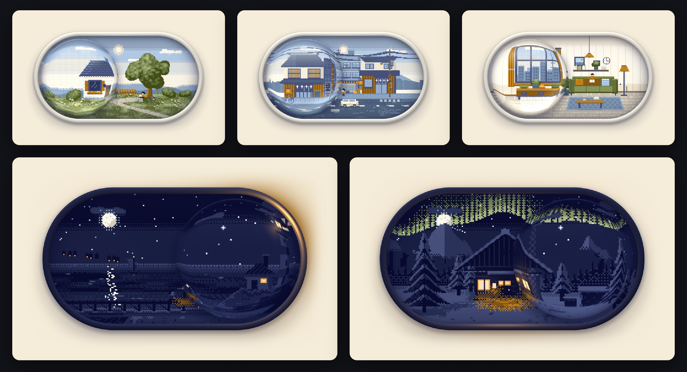

<div align="center">

[](https://xn--3bts89a.com/)

</div>

---

<a id="project-preview"></a>

[](README.md)
[](README.en.md)
[](README.ja.md)
[](CHANGELOG.md)
[](https://xn--3bts89a.com/)

<details>
<summary>Pixel Daylight Switch</summary>

<a href="https://xn--3bts89a.com/?work=pixel-daylight-switch" target="_blank" rel="noopener noreferrer"></a>

</details>

[](#project-preview)

## Project Structure

```text
gongshui-pages/
├── index.html                                  # Main entry point containing the gallery, work cards, detail panels, and page structure.
├── login.html                                  # Account sign-in and registration page.
├── admin.html                                  # Website administration dashboard.
├── privacy.html                                # Privacy policy page.
├── banner.png                                  # Project banner displayed at the top of the README.
├── scene-gallery.png                           # Multi-scene preview image for Pixel Daylight Switch; clicking opens its expanded detail view.
├── readme-directory002.svg                         # SVG graphic introducing the project's purpose and identity.
├── readme-banner.svg                           # Social and update banner displayed near the bottom of the README.
├── README.md                                   # —
├── README.en.md                                # —
├── README.ja.md                                # —
├── CHANGELOG.md                                # Version history and release notes.
├── CNAME                                       # Custom domain configuration for GitHub Pages.
├── vercel.json                                 # Vercel deployment and routing configuration.
│
├── styles/                                     # Stylesheets for the site's pages and components.
│   ├── style.css                               # Main styles for the homepage and shared interface.
│   ├── admin.css                               # Styles specific to the admin dashboard.
│   ├── globe.css                               # Styles for the globe and compass view.
│   └── orbit-art.css                           # Styles for the Pixel Orbit artwork display.
│
├── scripts/                                    # JavaScript modules for page interactions and application features.
│   ├── main.js                                 # Core logic for work cards, detail views, expansion, and related interactions.
│   ├── home-page.js                            # Homepage navigation, search, and interface behavior.
│   ├── auth.js                                 # User authentication and sign-in flow.
│   ├── auth-config.js                          # Client-side configuration for the authentication service.
│   ├── auth-landing.js                         # Landing-page interactions related to authentication.
│   ├── account.js                              # Frontend logic for account profiles and account state.
│   ├── login-page.js                           # Interactions for the sign-in and registration page.
│   ├── admin.js                                # Admin dashboard features and interactions.
│   ├── admin-liquid-glass.js                   # Liquid-glass interface effects for the admin dashboard.
│   ├── globe.js                                # Globe view and related location and contributor interactions.
│   ├── compare.js                              # Work version and view comparison features.
│   ├── nav-history.js                          # In-site view navigation and history-state management.
│   ├── scroll-ui.js                            # Scroll-related interface behavior and controls.
│   ├── orbit-versions.js                       # Version switching for the Pixel Orbit artwork.
│   ├── sync.js                                 # Synchronization of user preferences and account data.
│   ├── risk.js                                 # Risk detection and security validation logic.
│   ├── fingerprint.js                          # Browser-environment identification utilities.
│   ├── privacy-cleanup.js                      # Privacy cleanup and local-data handling.
│   └── vendor/                                 # Third-party or minified vendor scripts.
│       └── globe.gl.min.js                     # globe.gl library used for 3D globe visualization.
│
├── assets/                                     # Static assets such as images, icons, and other media.
│   ├── earth/                                  # Textures and map resources used by the globe view.
│   ├── flags/                                  # Country and region flag assets.
│   └── badges/                                 # README badges and technology-stack graphics.
│       └── tech-stack.svg                      # Minimal monochrome graphic listing the main technologies used.
│
├── data/                                       # Structured data used by the website.
│   ├── contributors.json                       # Contributor information and related metadata.
│   └── ne_110m_admin_0_countries.geojson       # Country and region boundary data for the globe view.
│
├── auth/                                       # Authentication callback and confirmation pages.
│   ├── confirm.html                            # Account verification or confirmation page.
│   └── confirm/index.html                      # Directory-style entry point for account confirmation.
│
└── supabase/                                   # Supabase database schemas, functions, and migrations.
    ├── schema.sql                              # Base database schema.
    ├── account-usernames.sql                   # Database definitions for account usernames.
    ├── linked-accounts.sql                     # Database definitions for linked accounts.
    ├── admin.sql                               # Database definitions for admin features.
    ├── risk.sql                                # Database definitions for risk-control features.
    ├── security-audit.sql                      # Database definitions for security auditing.
    ├── functions/                              # Server-side functions such as Supabase Edge Functions.
    └── migrations/                             # Database schema changes and migration history.
```

### Technology Stack


## Privacy

We respect every user's privacy. Account information is used only to provide the website's services and is protected with appropriate measures. We do not disclose it publicly or share it with unrelated third parties, except where necessary to operate the service, authorized by the user, or required by law.

See our [Privacy Policy](privacy.html) for details.

[](https://x.com/gsyxyc)

## License

This project is licensed under the [MIT License](LICENSE).
